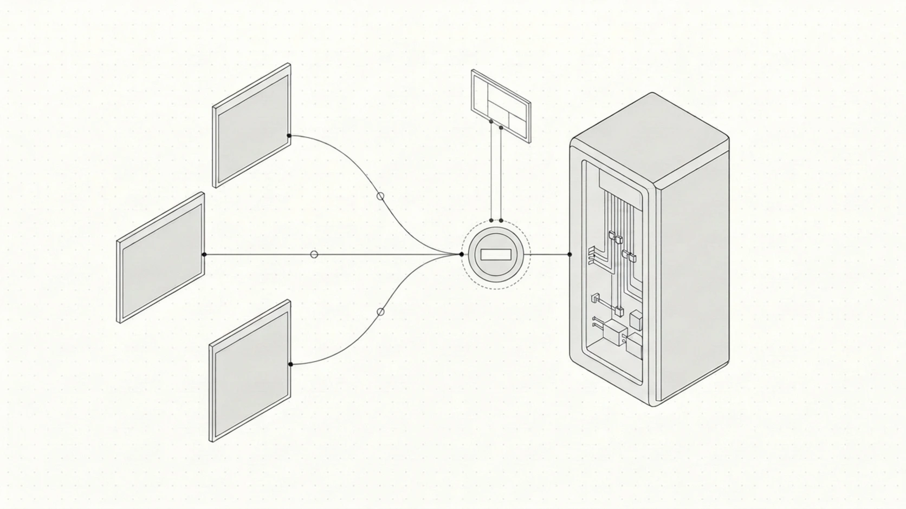
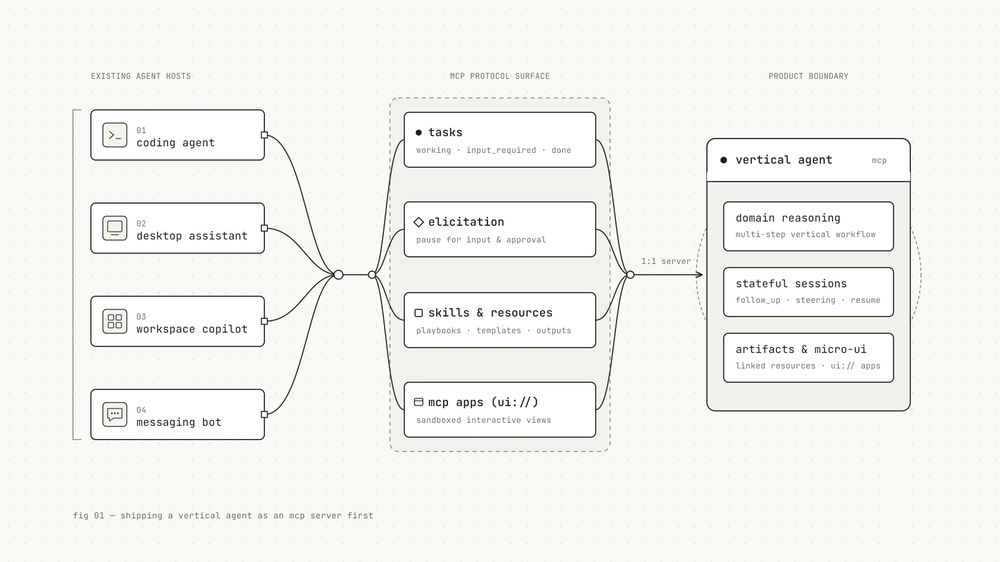
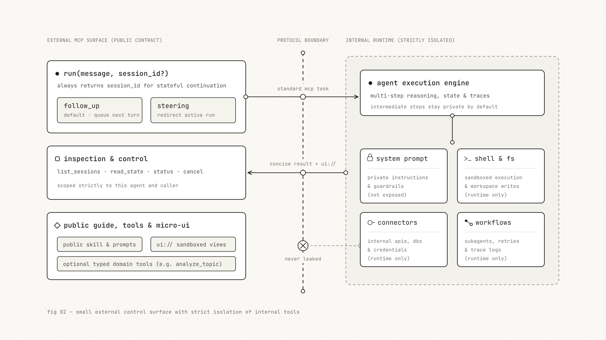
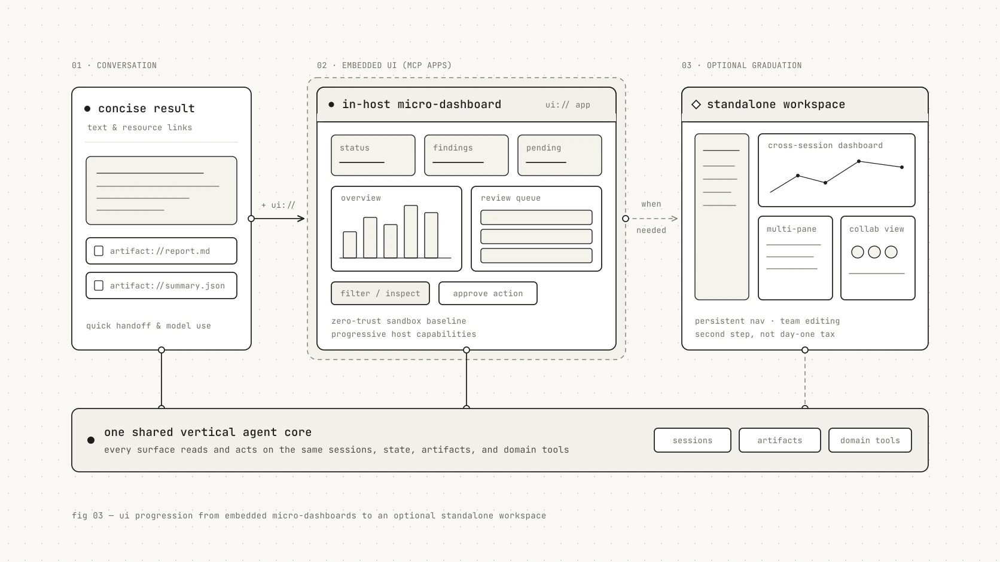

*For a long time, building a vertical agent meant building another standalone chat app. Modern MCP extensions suggest a different starting point.*

Most teams building a vertical agent still default to the same blueprint: a standalone web app, a custom chat interface, a bespoke streaming protocol, custom authentication, and yet another browser tab competing for user attention.

Even when the underlying domain capability is strong, that packaging creates real friction. Users already live inside general-purpose agent hosts: coding agents, desktop assistants, workspace copilots, and messaging bots. Asking them to copy context out of their daily environment and into a separate vertical app breaks the flow before the agent gets a chance to prove its value.

An alternative is becoming surprisingly viable: **ship your vertical agent as an MCP server first.**

## Beyond Stateless Tool Wrappers

Early on, the Model Context Protocol looked like an awkward fit for a real vertical agent. Most MCP servers were thin wrappers around stateless APIs: search a database, fetch a document, create an issue, return JSON in a few hundred milliseconds.

A vertical agent rarely works like that. It runs for minutes, not milliseconds. It maintains multi-turn state across a session. It pauses halfway through to ask for clarification or approval. It carries domain playbooks that callers need to understand. And when it finishes, or asks a user to review a complex artifact, plain text is often the wrong interface.

Recent extensions to MCP address those exact gaps, one by one:

- **Tasks** turn long-running execution into a first-class protocol lifecycle (`working`, `input_required`, `completed`, `failed`, `cancelled`) instead of forcing timeouts or ad-hoc polling hacks.
- **Elicitation** gives a running agent a structured way to pause and ask the user for missing inputs or confirmations inside whatever host they are already using.
- **Skills, Prompts, and Resources** let an agent expose how it should be used, reusable task templates, and structured outputs or artifacts.
- **MCP Apps (`ui://`)** allow a server to deliver lightweight, sandboxed interactive HTML surfaces directly inside the host conversation, turning a text-only tool call into a review board, diff viewer, or approval panel.

Put together, these primitives are no longer just a connector standard. They look much closer to an application entrypoint.

> **MCP used to be how an agent reached out to tools. Increasingly, it can also be how a vertical agent presents itself as a product.**

## Designing a Vertical Agent as an MCP Server

Treating an MCP server as a product boundary, rather than an afterthought glued onto an existing API, forces a few sharp architectural choices. Most of them make the system simpler, not more complex.

### 1. One Vertical Agent, One MCP Server

It is tempting to put a fleet of agents behind a single multiplexing MCP server with an `agent` parameter on every tool. In practice, that quickly works against the protocol.

In MCP, server metadata, capabilities, tool lists, skills, prompts, and UI resources are all scoped at the server level. Mixing multiple unrelated agents into one endpoint forces artificial naming prefixes, muddies descriptions, and couples access control across agents that should be published and authorized independently.

Giving each vertical agent its own MCP endpoint keeps the abstraction clean: connect to the server, and everything it advertises—its entrypoints, domain guide, prompts, and UI—belongs to that product. If a developer truly wants one entrypoint coordinating several specialists, an orchestrator agent can still hide subagents behind a single server boundary.

### 2. A Small Control Surface, and Strict Isolation of Internal Tools

A vertical agent's internal tools—shell access, filesystem writes, private connectors, and internal workflows—belong to the agent's own runtime. They should never leak automatically into the external MCP tool list.

Instead, the external MCP surface can stay intentionally small and predictable:

- **A default `run` entrypoint** that accepts a message and an optional `session_id`, always returning the `session_id` so the caller can explicitly continue a stateful conversation or start an isolated one in parallel.
- **Explicit multi-turn semantics** when a session is already busy: defaulting to `follow_up` (queuing the next turn cleanly as a new task) while supporting `steering` (injecting course-correction into an active run without spawning a competing task).
- **Standard inspection and control operations**—listing sessions, reading session state and messages, checking run status, and cancelling a run—scoped strictly to that agent and caller. Even clients that do not yet implement the latest MCP Tasks extension can work reliably out of the box.
- **Optional domain-specific tools** layered on top when a vertical workflow benefits from typed inputs (such as `analyze_topic` or `draft_campaign`) or deterministic actions backing a UI view.

The same isolation rule applies to instructions. An agent's internal system prompt is an implementation detail; what external callers need is an explicit public guide or skill describing what the agent is good at, what inputs it expects, and what outputs it returns.

### 3. Keep the Protocol Boring About Intermediate Steps

When wrapping a multi-step agent behind MCP, there is a strong urge to stream every intermediate thought, tool call, and sub-step through custom protocol fields.

Resist that urge.

For the calling host model, dumping dozens of intermediate traces into tool outputs mostly burns context window and degrades downstream reasoning. For interoperability, custom trace fields break the point of using a standard protocol in the first place.

A cleaner boundary is to let MCP Tasks stay strictly standard: lifecycle status, elicitation when input is required, and a concise final outcome, with large artifacts linked as resources rather than inlined. Rich step-by-step inspection belongs either in a dedicated first-party view or in a `ui://` app attached to the result.

### 4. Rethinking the Vertical Dashboard: Embedded Micro-UI First, Standalone Workspace Later

Rich UI is usually the main reason teams hesitate to give up a standalone frontend. A vertical agent rarely ends with a paragraph of text. Users expect a domain dashboard, a review queue, a comparison board, a diff viewer, or an approval panel where they can inspect structured work and make decisions visually.

Traditionally, needing that kind of interface forced teams to build a full web application from day one, complete with navigation, chat chrome, account management, and layout scaffolding, just to have a place to render the dashboard.

MCP Apps (`ui://`) open up a more gradual path. Instead of choosing between plain text and a standalone app, a vertical agent can bundle lightweight, self-contained HTML views (`text/html;profile=mcp-app`) alongside the server and attach them directly to tool results. A focused mini-dashboard, status board, or review workspace can appear right inside the host conversation the user is already in, calling back into the server's tools and resources for drill-downs, filters, or approvals.

Treating embedded UI as the first surface also clarifies how trust and portability should work:

- **Start with a zero-trust baseline.** Self-contained documents, no arbitrary outbound network access, and explicit host-mediated callbacks back to the server's tools and resources keep a view portable across any compliant MCP host.
- **Layer smoother UX as progressive enhancement.** Real dashboard interactions quickly expose friction if every read-only click triggers a confirmation dialog or if rich media assets exceed inline limits. Treating extra capabilities, such as allowlisted asset domains or host policies that relax confirmation on explicitly read-only actions, as progressive enhancements lets richer hosts feel fluid without breaking baseline portability.
- **Graduate to a standalone dashboard only when the workflow outgrows an inline pane.** Many daily vertical interactions turn out to fit comfortably inside host-embedded views. When users genuinely need persistent multi-pane navigation, cross-session analytics, or collaborative editing, a dedicated web workspace still makes sense—only now it becomes a deliberate second step rather than an upfront tax.

### 5. One Agent Core, Multiple Entrypoints

Finally, packaging a vertical agent as an MCP server should not mean building or maintaining a second execution engine.

The cleanest boundary is conceptual: authentication and access control live at the edge, while the MCP surface sits as a thin, standard adapter over the same core sessions, state, cancellation, and artifacts that power the agent everywhere else. When a team later adds a standalone dashboard or a native CLI alongside the MCP server, every entrypoint talks to the same underlying sessions rather than fragmenting user work across separate silos.

## A Better First Distribution Boundary

Building a vertical agent as an MCP server does not mean you will never build a standalone web application. Some workflows genuinely need a full-screen workspace, collaborative editing, or deep custom navigation.

What it changes is where you start.

Instead of spending the first month rebuilding chat chrome, session management, auth flows, and polling glue just to put a domain agent in front of users, you can focus on what actually differentiates a vertical agent: domain reasoning, stateful execution, clear public skills, and focused micro-UI.

> **Ship the vertical agent as a complete MCP server first. Let the hosts users already live in become your distribution surface.**
